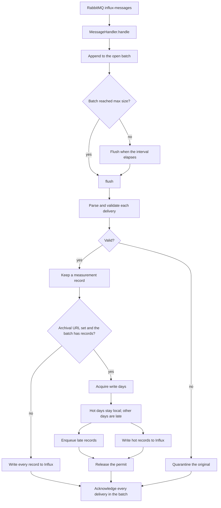

# Architecture

[Documentation index](README.md)

The process entrypoint is `main.py`. `archive.py` is the client for the hot-to-cold loader. There is no separate package tree.

| Module | Responsibility |
| --- | --- |
| `main.py` | Broker and Influx connections, batching, validation, writes, acknowledgement, metrics |
| `archive.py` | UTC day calculation, late-record encoding, and the coordination HTTP client |

## What a message becomes

Each body is a Waggle message. A valid message has a name of at most 64 characters, a signed int64 nanosecond timestamp, a value that is an integer, float, or string, and string metadata. Metadata keys are at most 64 characters and values at most 256. `node` is required, and `node-` plus that tag must equal the RabbitMQ `user_id`. Non-finite floats are rejected.

Integers are coerced to floats before the Influx write. Strings stay strings. The Influx point uses the measurement name, the metadata as tags, one field named `value`, and the original timestamp at nanosecond precision.

## Batching and acknowledgement

The consumer prefetches deliveries and appends them to one batch. The first delivery in an empty batch schedules a flush; the batch also flushes when it reaches the configured size. One flush uses one idempotency key. That key stays the same if the in-memory flush is retried. A new process creates a new key.

Acknowledgement happens only after the flush finishes. That includes the Influx write, any late-record receipt, permit release, and quarantine of invalid deliveries in the same batch. A failed flush stops consumption and leaves the broker deliveries unacknowledged. A partial Influx write is a failure. The loader does not acknowledge the batch and then repair it.

Invalid deliveries are removed from the write set and quarantined. They are still acknowledged with the rest of the batch once quarantine has succeeded. A quarantine failure leaves the whole batch unacknowledged.

## Archival coordination

An empty `HOT_TO_COLD_LOADER_URL` disables coordination. Every valid record is written to Influx, and invalid originals go to the durable `influx-messages-quarantine` queue with publisher confirms.

A set URL requires the loader token and owner. The client appends a process UUID to the owner prefix. Before writing, the loader asks the archiver which of the batch's UTC days are still hot. Days the archiver returns are written to Influx. Any other day is encoded and posted to the late inbox, with the original nanosecond timestamp. Empty tag values are omitted from that encoding. The permit is released only after the hot write and the late receipt succeed. A coordinator error does not fall back to a direct Influx write.

The day of a timestamp is its UTC calendar day. The instant one nanosecond before midnight belongs to the previous day. The calculation uses integer seconds so a nanosecond value cannot round across that boundary.

Writer permits have renewable deadlines. Acquire returns the admitted days and `expires_at`; renewal runs in a background thread every minute or one-third of remaining time, whichever is shorter. Renewal never changes the admitted days. The loader checks its monotonic confirmed deadline before hot IO and before finishing the batch. Release includes the process owner and must be confirmed before acknowledging broker messages.

A failed/partial write, lost lease, or failed release leaves the batch unacknowledged and stops renewal. Consumption exits; broker redelivery obtains new admission, routing fenced days through the late inbox. The coordinator stops waiting after the last confirmed expiry plus one minute of drain grace. Expired/released permits cannot renew. Initial/renewed duration is configured on the coordinator using `--write-lease-duration` (default 30 minutes).

A lease cannot cancel a request already executing in Influx. The synchronous write uses the configured finite client timeout; an expired in-flight write may still finish at the server. Recovery depends on durable unacknowledged broker messages being redelivered. Deploy renewal-aware writers with the coordinator and drain older writers before resuming archival. See the [hot-to-cold loader guide](https://github.com/waggle-sensor/beehive-hot-to-cold-loader/blob/main/docs/operations.md).
